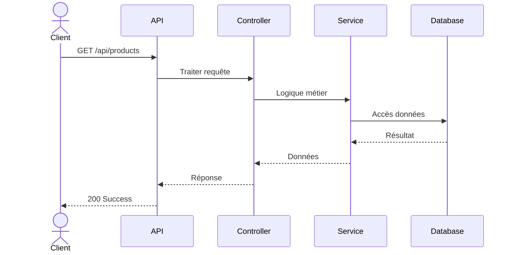
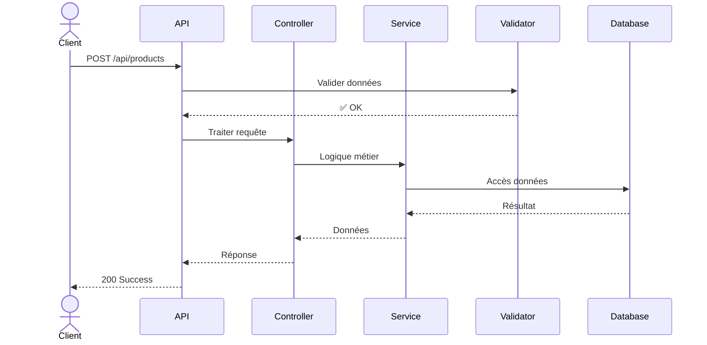

# Module products

## Vue d'ensemble

| Méthode | Route | Description |
|---------|-------|-------------|
| 📖 **GET** | `/api/products` | Ce endpoint retourne la liste des produits disponibles, fournissant ainsi un aperçu global des articles offerts par l'entreprise. |
| ➕ **POST** | `/api/products` | Ce endpoint permet d'ajouter un nouveau produit dans la base de données, en recevant les informations du nouveau produit (par exemple : nom, description, prix, etc.) dans le corps de la requête POST. |

---

## 📖 GET /api/products

**Description:** Ce endpoint retourne la liste des produits disponibles, fournissant ainsi un aperçu global des articles offerts par l'entreprise.

**Flux d'exécution:**

---

## ➕ POST /api/products

**Description:** Ce endpoint permet d'ajouter un nouveau produit dans la base de données, en recevant les informations du nouveau produit (par exemple : nom, description, prix, etc.) dans le corps de la requête POST.

**Flux d'exécution:**

---

